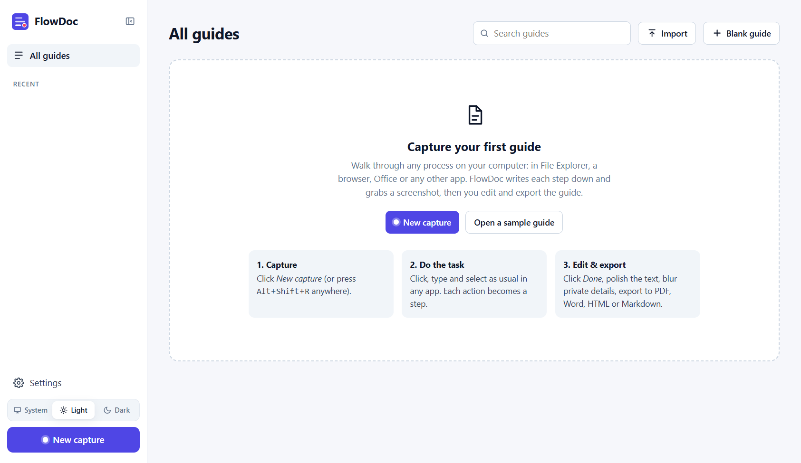
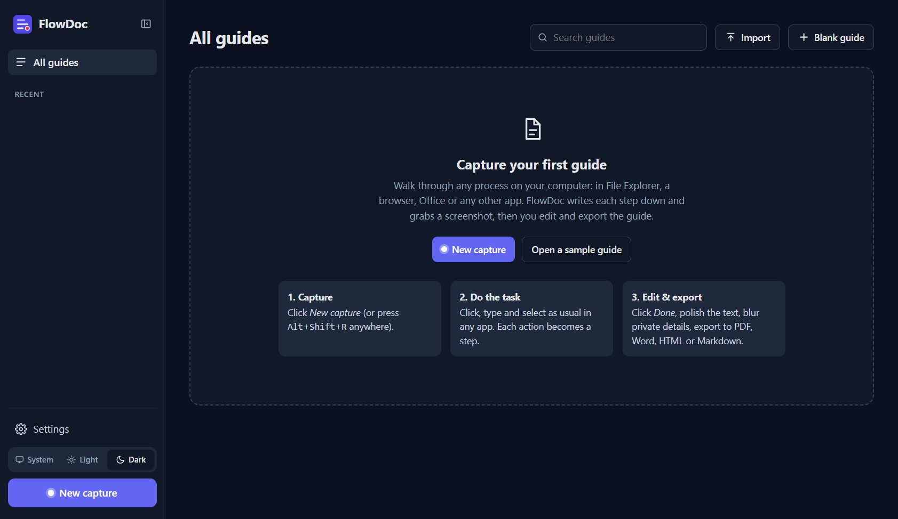
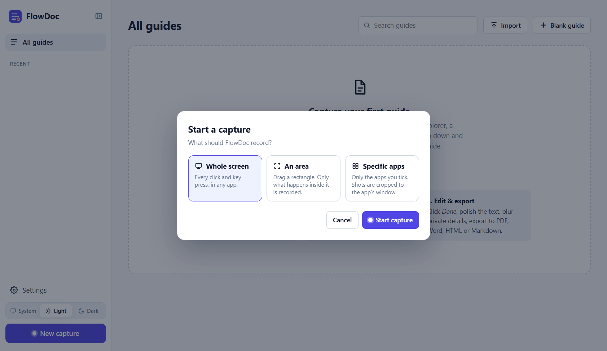
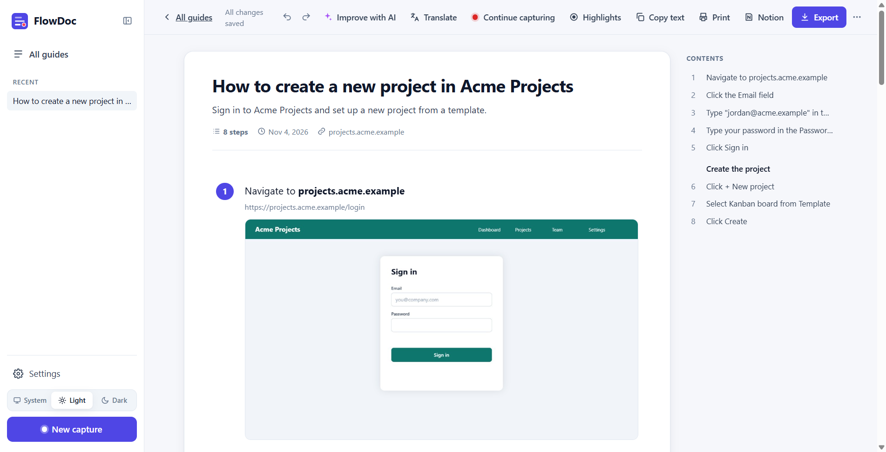
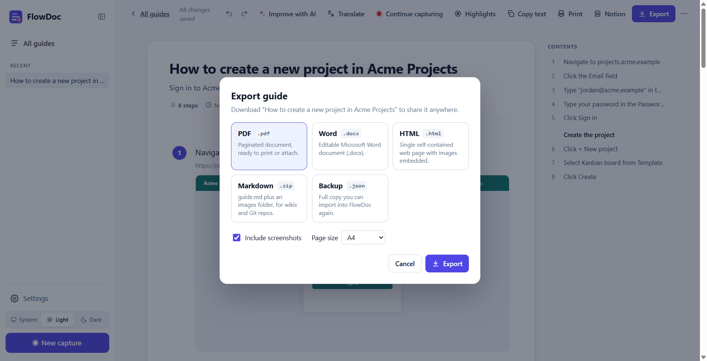
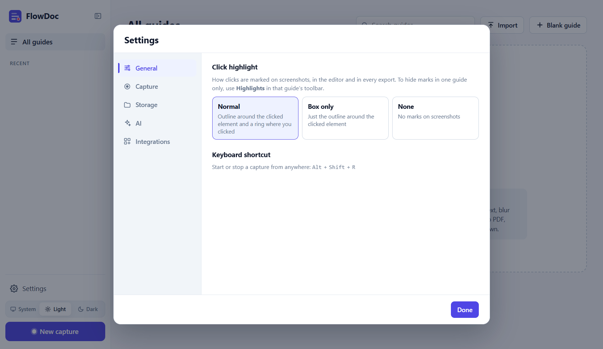
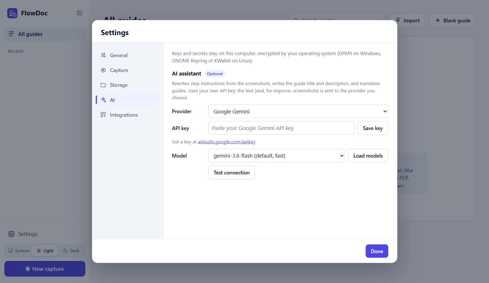

# FlowDoc

Record a process once and get a step-by-step guide with annotated screenshots, in the style of Scribe (scribehow.com). Edit the guide, blur private details, and export it as **PDF, Word (.docx), HTML, Markdown** or a JSON backup. The desktop app can also save guides straight to **Notion**.

Everything runs on your computer. There is no account and no server. The only data that ever leaves your machine is what you choose to send to an AI provider (desktop app or extension) or to Notion (desktop app or extension), and both are off by default.

## Contents

- [Screenshots](#screenshots)

1. [Before you start: what you need](#1-before-you-start-what-you-need)
2. [Which version should I use?](#2-which-version-should-i-use)
3. [Get the code](#3-get-the-code)
4. [Guide A: Desktop app (Windows and Linux)](#guide-a-desktop-app-windows-and-linux) (recommended)
5. [Guide B: Chrome / Edge extension](#guide-b-chrome--edge-extension) (not yet tested in Chrome)
6. [Guide C: Editing and exporting a guide](#guide-c-editing-and-exporting-a-guide) (the same in both versions)
7. [Web workspace (no install)](#web-workspace-no-install)
8. [For developers](#for-developers)
9. [Limitations](#limitations)
10. [License](#license)

## Screenshots

**Home page**, in light and dark mode (pick System, Light or Dark at the bottom left):

| Light | Dark |
| --- | --- |
|  |  |

**Start a capture**: record the whole screen, only an area, or only the apps you choose.



**Inside a guide**: edit steps, then use the toolbar to Improve with AI, Translate, Continue capturing, toggle Highlights, Copy (as text or Markdown), Print, save to Notion, or Export.



**Export**: PDF, Word (.docx), HTML, Markdown (.zip with images) or a JSON backup, with or without screenshots.



**Settings**: a sidebar of sections. **General** (click highlight style), **Capture** (capture options), **Storage** (guides folder), **AI** (optional assistant, Gemini or Groq) and **Integrations** (optional Notion).

| | |
| --- | --- |
|  |  |

---

## 1. Before you start: what you need

> **Install Node.js and Git first.** Everything else (Electron, the recorder, the export libraries) is downloaded by `npm install` in step 3.

### Required

| What | Version | Where to get it | How to check it's installed |
| --- | --- | --- | --- |
| **Node.js** (includes **npm**) | 18 or newer. The **LTS** version is recommended. | [nodejs.org/en/download](https://nodejs.org/en/download) | `node -v` shows v18 or higher, and `npm -v` shows a version number |
| **Git** | Any recent version | [git-scm.com/downloads](https://git-scm.com/downloads) | `git --version` shows a version number |

**Installing on Windows:**

- **Node.js:** run the `.msi` installer and keep the defaults. Make sure **npm package manager** and **Add to PATH** stay selected. You do **not** need the optional "Tools for Native Modules" (Visual Studio Build Tools); FlowDoc's recorder ships ready-built.
- **Git:** run the Git for Windows installer and keep the defaults.
- **Afterwards:** close and reopen your terminal (Command Prompt, PowerShell or Windows Terminal) so it picks up the new programs, then run the check commands above.

**Installing on Linux:**

- **Node.js:** use the official installer, or your distribution's package (Ubuntu 22.04's default is too old, so prefer the NodeSource or nvm instructions linked from the Node.js download page).
- **Git:** usually `sudo apt install git` (Debian/Ubuntu) or `sudo dnf install git` (Fedora).

**You'll also need:**

- an internet connection for `npm install`, which downloads about 500 MB the first time;
- about **1 GB of free disk space**: roughly 500 MB for the project's dependencies, plus room for screenshots and, if you build installers, about 400 MB more.

### For the desktop app

- **Windows 10 (version 2004 or newer) or Windows 11.** Version 2004 or newer is needed to keep the recorder bar out of screenshots.
- **Linux:** a desktop session running **X11 (Xorg)**, not Wayland, plus a few system packages. See [Linux: one-time setup](#linux-one-time-setup).
- **macOS** isn't supported yet.

### For the browser extension

- [Google Chrome](https://www.google.com/chrome/) or [Microsoft Edge](https://www.microsoft.com/edge), a recent version.

### Optional

| For | You need | Where |
| --- | --- | --- |
| AI (Improve with AI and Translate), in the desktop app or the extension | A Google Gemini **or** Groq API key (both have free tiers) | [aistudio.google.com/apikey](https://aistudio.google.com/apikey) · [console.groq.com/keys](https://console.groq.com/keys) |
| Save to Notion, in the desktop app or the extension | A Notion account and an integration you create | [notion.so/profile/integrations](https://www.notion.so/profile/integrations) |

---

## 2. Which version should I use?

| | Desktop app (recommended) | Chrome / Edge extension |
| --- | --- | --- |
| Records | Clicks and typing in **any app**: File Explorer / Files, browsers, Office, Settings, terminals… | Clicks and typing inside **browser tabs** |
| Platforms | Windows 10/11, Linux (X11 session) | Chrome, Edge (Windows, Linux, macOS) |
| Install | Run from source, or build an installer | Load the `extension` folder into the browser |
| Tested | Yes, on Windows (Linux not yet on real hardware) | Automated test in Microsoft Edge only; **not yet tested by hand in Chrome** |
| What to record | Whole screen, an area, or only the apps you choose | The browser tab you pick |
| Improve with AI (Gemini / Groq) | Optional: Crisp, Elaborate or Conceptual. Key encrypted with your system keychain. | Optional: same styles. Key kept in browser storage, encrypted (AES-GCM). |
| Translate a guide | Optional (needs AI) | Optional (needs AI) |
| Continue capturing | Yes | Yes |
| Save to Notion | Optional | Optional |
| Your own guides folder | Yes | — (stored in the browser) |
| Click highlight style (Normal / Box only / None) | Yes, in Settings | — (only the per-guide **Highlights** toggle) |
| Light / Dark / System theme | Yes | Yes |
| Editor and exports | Same | Same |

Start with the **desktop app**: it records everything, including work in other programs such as saving a file in File Explorer, changing a Windows setting or using Excel. The **extension** suits processes that happen entirely in a web browser.

## 3. Get the code

Make sure Node.js and Git are installed ([section 1](#1-before-you-start-what-you-need)), then run these commands in a terminal:

```bash
git clone https://github.com/avin045/FlowDoc.git
```

```bash
cd FlowDoc
```

```bash
npm install
```

`npm install` downloads the desktop runtime (Electron), the global input hook and the test tools. It also copies the PDF, Word and zip libraries into `extension/vendor/`. That step matters because browser extensions aren't allowed to load code from the internet.

---

## Guide A: Desktop app (Windows and Linux)

### A1. Install

#### Option 1: Run it from the source code (quickest)

In the `FlowDoc` folder:

```bash
npm run desktop
```

The FlowDoc window opens, and a FlowDoc icon appears in the system tray (Windows: bottom-right, near the clock; Linux: top bar).

#### Option 2: Build and install it like a normal program

**Windows:**

```bash
npm run dist:win
```

The first build downloads the packaging tools (about 150 MB) and takes a few minutes. Later builds are faster. The build runs in a temporary folder, and the finished files are copied into `FlowDoc/dist/`:

- `FlowDoc Setup 1.1.1.exe`: an installer that adds Start-menu and desktop shortcuts. Double-click it and follow the wizard.
- `FlowDoc 1.1.1.exe`: a portable version that runs without installing.

The app isn't code-signed, so Windows SmartScreen may show **"Windows protected your PC"**. Click **More info → Run anyway**.

**Linux** (build on a Linux machine):

```bash
npm run dist:linux
```

This creates two files in `dist/`:

- `FlowDoc-1.1.1.AppImage`: make it executable with `chmod +x FlowDoc-1.1.1.AppImage`, then double-click it or run it from a terminal.
- `flowdoc_1.1.1_amd64.deb` (Debian/Ubuntu): install it with `sudo apt install ./flowdoc_1.1.1_amd64.deb`. This also installs the required system packages.

#### Linux: one-time setup

Do this before your first capture on Linux:

1. **Use an X11 (Xorg) session.** Wayland, the default on recent Ubuntu and Fedora, doesn't let apps see clicks in other windows.
   - Log out. On the login screen, click your name, then the **gear icon** at the bottom-right, and choose **"Ubuntu on Xorg"** (or "GNOME on Xorg" or "Plasma (X11)").
   - FlowDoc shows a yellow warning on its home screen when it detects Wayland.
2. **Install the helper packages.** The `.deb` package does this automatically. If you run from source or use the AppImage, install them yourself.
   - **Debian / Ubuntu:**

     ```bash
     sudo apt install libxtst6 libxkbfile1 python3-gi gir1.2-atspi-2.0 xdotool
     ```

   - **Fedora:** `sudo dnf install libXtst libxkbfile python3-gobject at-spi2-core xdotool`

   `python3-gi` and `gir1.2-atspi-2.0` let FlowDoc read button and field names. Without them, steps fall back to the window title, for example "Click in **Files**".

### A2. Record your first guide

1. Open the programs you'll use, and get to the point where your process starts.
2. Start a capture in any of these ways:
   - Click **New capture** at the bottom of FlowDoc's left sidebar.
   - Press **`Alt+Shift+R`**, which works from any app.
   - Right-click the **tray icon** and choose **Start capture**.
   With **New capture**, FlowDoc first asks **what to record**: **Whole screen**, **An area** or **Specific apps** (see [Record only an area or only some apps](#record-only-an-area-or-only-some-apps) below). It starts from your last choice. The shortcut and the tray icon always record the whole screen.
3. FlowDoc minimises itself, and a dark **recorder bar** appears at the bottom-centre of the screen. It shows:
   - the step count and elapsed time;
   - **Pause / Resume**: pause while you do something private;
   - **Trash**: discard the recording. Click it twice: the first click turns it red ("Discard?"), and the second, within 3 seconds, deletes the recording;
   - **Done**: stop and build the guide.

   To move the bar, drag it by its left part (the dot, the "Capturing" label and the counter).

   By default the bar is hidden from screen recorders and meeting apps (Teams, Zoom, Meet, OBS…), so people watching your shared screen don't see it. To let them see it, untick **Settings → Capture → Hide the recorder bar from screen recordings and meetings** ([A7](#a7-capture-settings)).
4. Work through your process normally, across as many apps as you like. For example: open File Explorer, double-click a folder, right-click and choose **New → Folder**, type a name, press Enter, then switch to the browser and upload the file.
5. When you're finished, click **Done** on the bar. You can also press `Alt+Shift+R` again, or use the tray icon's **Stop capture**.
6. FlowDoc comes back to the front with the finished guide open in the editor. Continue with [Guide C](#guide-c-editing-and-exporting-a-guide).

> **Tip:** move a little slower than usual and pause briefly after typing. The pause lets FlowDoc read the finished text from the field, so the step shows exactly what you typed.

#### Record only an area or only some apps

**An area** records only what happens inside a rectangle you choose:

1. Choose **An area** and click **Start capture**. FlowDoc steps aside and the screen dims (on every display).
2. Drag a rectangle, or click a window to take its whole frame. Move it by dragging the inside, and resize it with the handles.
3. Press **Enter**, double-click inside the area, or click **Start capture** below it. **Esc** or **Cancel** goes back without recording.
4. While capturing:
   - A thin **purple border** sits just *outside* the area. Nothing covers the area itself, and the border never appears in screenshots. It turns **grey** while paused.
   - The **recorder bar** works as usual (Pause, Discard, Done). If its usual place at the bottom of the screen is inside your area, it moves just above or below the area instead.
   - The bar's **Area** button lets you choose a new area. Capturing pauses while you choose, and **Esc** keeps the old area.
   - Clicks outside the area are ignored. Typing counts when the field is inside the area. Every screenshot is cropped to the area.
5. Click **Done**. The guide remembers its area, and your next area capture starts from the same rectangle.

**Specific apps** records only the apps you tick:

- Tick the apps in the list. Apps you chose before stay listed even when they're closed. **Taskbar & Start menu** is at the bottom if you want those clicks too.
- Each screenshot is cropped to the app's window. A menu or dialog that's smaller than the app keeps its window around it for context.
- Click in an app you didn't tick and the bar asks **"*App* isn't being captured"**. **Add** includes that app from then on, and also keeps the click you just made. **✕** stops asking about that app for this capture.
- The bar's app button (it shows the app's name, or "*N* apps") opens the list so you can change the apps while capturing.

### A3. What the desktop app writes for each action

| You do | Step written |
| --- | --- |
| Click a button, menu item, file or link | Click **New folder** |
| Click a text field | Click the **File name** field |
| Type into a field | Type "Q3 report" in the **File name** field |
| Type into a password field | Type your password in the **Password** field *(never stored)* |
| Tick a checkbox | Check **Hidden items** |
| Double-click | Double-click **Invoices** |
| Right-click | Right-click **report.pdf** |
| Press Enter / Esc / Delete / F2… | Press **Enter** |
| Keyboard shortcut | Press **Ctrl+S**, Press **Win+E** |
| Press the Windows / Super key alone | Press **Windows key** |
| Switch browser tabs (click a tab, `Ctrl+Tab`, `Ctrl+1`…), or type an address and press Enter | Navigate to **https://github.com/avin045/FlowDoc** *(with a screenshot of that page)* |

**Browser tabs (Windows):** in Chrome, Edge, Brave, Vivaldi, Opera and Firefox, FlowDoc reads the page's link from the address bar, so switching to another tab writes **Navigate to** with that link instead of "Open the … tab". Switching to the page the guide is already on adds nothing. On Linux FlowDoc can't read the link, so a tab click stays an ordinary click step.

Under each step the editor shows which app and window it happened in, for example "File Explorer · Downloads".

Element names come from the operating system's accessibility features: UI Automation on Windows, AT-SPI on Linux. A few apps don't expose names. For those you'll see "Click in **App name**", and **Improve with AI** (below) can fix the wording from the screenshot.

### A4. Privacy while recording

- **Passwords:** password fields are detected and their contents are never saved.
- **The recorder bar** never appears in FlowDoc's screenshots. On Windows it is hidden from all screen captures by default. If you make it visible to other apps ([A7](#a7-capture-settings)), FlowDoc still leaves it out of its own screenshots: at each step it hides the bar from captures for a moment (about a fifth of a second) and fills in what is behind it, so people watching may see the bar blink once per step. On Linux, where windows can't be hidden from captures, FlowDoc blurs the bar out of each step's screenshot instead (you can remove the blur in the screenshot editor).
- **Clicks inside FlowDoc's own windows** are ignored.
- **Screenshots:** if one shows something private, blur it afterwards with the screenshot editor ([C4](#c4-blur-private-information-crop-or-change-the-highlight)).
- **Typed text:** to keep it out of guides entirely, untick **Settings → Capture → Include typed text in steps**.

### A5. Optional: AI write-ups with Gemini or Groq

The AI assistant turns recorded steps into polished instructions by looking at each step's screenshot. For example, "Click in **File Explorer**" becomes "Click **New folder** in the toolbar". It also writes a "How to…" title and a short description for the guide, and it can **translate** a guide into Tamil, Hindi and many other languages ([C10](#c10-translate-a-guide)). It's optional and off by default, and it uses **your own API key**. The browser extension has it too ([B5](#b5-optional-ai-improve-and-translate-in-the-extension)).

**Step 1: Get an API key (free tiers are available).**

- **Google Gemini:**
  1. Go to https://aistudio.google.com/apikey and sign in with a Google account.
  2. Click **Create API key** and copy the key.
- **Groq:**
  1. Go to https://console.groq.com/keys and sign up or sign in.
  2. Click **Create API Key**, give it a name, and copy the key. Groq only shows it once.

**Step 2: Connect it to FlowDoc.**

1. In FlowDoc, click **Settings** (gear icon) at the bottom of the left sidebar, then **AI** in the Settings sidebar.
2. Under **AI assistant**, set **Provider** to **Google Gemini** or **Groq**.
3. Paste your key into **API key** and click **Save key**. The box changes to "Saved…".
4. Leave **Model** at the default (`gemini-3.6-flash` for Gemini, `qwen/qwen3.8-27b` for Groq), or click **Load models**. The dropdown then lists every model your key can use that writes text, grouped as **Recommended** and **All models for your key**. Speech, image, embedding and transcription models are left out. To use a model that isn't listed, pick **Other — type a model ID…**. The list is remembered between sessions.
   - Newer isn't always faster. In October 2026, `gemini-3.8-flash` was so overloaded that a single screenshot took over 90 seconds, while `gemini-3.6-flash` handled four in about 4 seconds.
   - For Groq, choose a model that supports images (vision). Text-only models can still write titles, but they can't read the screenshots.
5. Click **Test connection**. You should see **✓ Connected**.
6. Click **Done**.

AI never runs on its own: a finished capture opens as recorded, and nothing is sent to the provider until you click **✨ Improve with AI**.

**Step 3: Use it.**

1. Open a guide. An **✨ Improve with AI** button now appears in the top toolbar.
2. Click it and choose a **writing style**:

   | Style | What it does | Sends screenshots? |
   | --- | --- | --- |
   | **Crisp** | One short sentence per step (never more than two lines), no notes. Removes notes left by an earlier AI run, but keeps notes you wrote yourself. | No: text only, so it's the fastest. The whole guide usually goes in one request. |
   | **Elaborate** | A clear instruction plus a short note with genuinely useful detail: what the action does, what appears next, or which option to pick. No filler. | Yes |
   | **Conceptual** | First reads the whole guide to understand what you were trying to accomplish. Then explains each step in plain, friendly language (why it matters, not just what to click), and adds section headings to longer guides. | Yes |

   Your choice is remembered for next time.
3. Choose **Rewrite the step instructions**, **Write the title and description**, or both, and click **✨ Improve**.
4. The dialog shows live progress, for example "16 of 40 steps done · 1 min 10 s · about 2 min left". There is **no time limit**. The work runs in the background:
   - Click **Keep working** to close the dialog and carry on editing, or open other guides. A progress strip stays at the top of the guide, and a ✨ appears next to it in the sidebar.
   - When it finishes, the result is applied, even if you've opened another guide meanwhile. FlowDoc shows a message, and a Windows/Linux notification if you're in another app.
   - Big guides (more than 20 steps) say up front that they may take a few minutes.
   - **Stop** cancels the job without changing anything.
5. Not happy with the result? Press **Ctrl+Z**, or click the undo arrow, to revert everything in one go. Steps you edited while the job was running are left as you wrote them.

**What you should know:**

- **What is sent:** each step's screenshot (cropped around the click) and its text go to the provider you chose, under that provider's terms. Don't use it on guides containing data you're not allowed to share. Blur the screenshots first ([C4](#c4-blur-private-information-crop-or-change-the-highlight)).
- **Guard rails:** the AI may reword a step, but it can never add a typed value that wasn't recorded. A made-up password, for example, is automatically rejected, and the original wording is kept.
- **Key storage:** your API key is encrypted with your system keychain (Windows DPAPI; GNOME Keyring or KWallet on Linux) and never leaves FlowDoc's main process.
- **Speed:** Crisp sends the step text only. Elaborate and Conceptual send 5 steps per request for Gemini (3 for Groq, which accepts at most 3 images), several requests at once, and the title is written at the same time. FlowDoc also turns the models' "thinking" down (minimal or low thinking for Gemini, `reasoning_effort: none` for Groq Qwen), because guide text doesn't need deep reasoning.
- **Automatic fallback:** if the chosen Gemini model is overloaded (503) or out of quota (429), that request moves to `gemini-3.6-flash` and then `gemini-3.5-flash-lite` straight away. The final message tells you when another model answered. **Test connection** in Settings shows which model answered and how long it took. A slow model is never cut off; the only limit is a 10-minute safety net per request against connections that hang forever.
- **Failures:** steps that did come back are still applied. If nothing comes back, the dialog stays open with the reason and a **Try again** button.
- **Rate limits:** free tiers limit requests per minute. FlowDoc retries automatically after a short wait.

### A6. Optional: Save guides to Notion

FlowDoc can turn a guide into a Notion page, with every screenshot uploaded, under any page you choose. The extension does the same ([B6](#b6-optional-save-to-notion-from-the-extension)). Each person connects their own workspace. You don't need a FlowDoc account or a developer setup: just a Notion integration you create in two minutes.

**Step 1: Create a Notion integration (one time).**

1. Open https://www.notion.so/profile/integrations and click **New integration**.
2. Name it **FlowDoc**, choose your workspace, and keep the type **Internal**. Save.
3. Under **Capabilities**, make sure **Read content**, **Insert content** and **Update content** are ticked.
4. Copy the **Internal Integration Secret**. It starts with `ntn_`.

**Step 2: Connect it to FlowDoc.**

1. Click **Settings** in FlowDoc's sidebar, then **Integrations**. Under **Notion**, paste the secret into **Secret** and click **Save**.
2. **Test connection** shows your workspace name and how many pages FlowDoc can see.
3. You can also do this from the **Notion** button the first time you use it.

**Step 3: Share the destination page with the integration.**

In Notion, open the page where guides should go (for example "Team wiki"), click **•••** at the top right, choose **Connections**, and add **FlowDoc**. Every page inside it becomes available too. Notion only lets FlowDoc see pages you've shared like this.

**Step 4: Save a guide.**

1. Open the guide and click **Notion** in the top toolbar.
2. Choose where to save it. The picker works like folders:
   - The top level lists the pages you shared with FlowDoc. Click a page to open it and see its subpages, then click a subpage to go deeper, as many levels as you need. Subpages placed inside columns or toggles are included.
   - The path bar shows where you are, for example *Workspace › AWS Trial › some_topic › some_topic_2*. Click any part of it to go back up.
   - The guide is saved inside the page you're in.
   - Or type in **Search all pages** to search the whole workspace; clicking a result jumps straight to it, with its full path.
   - **Recent** lists the last 5 places you saved to, and the dialog opens at the last one, so you rarely need to browse again.
   - **★ Save location** names the current place, for example "AWS LEARNING" for *AWS Trial / some_topic / some_topic_2*. Saved locations appear as chips at the top; one click jumps there. You can keep up to **10**. With 10 saved, the button tells you to remove one (✕ on its chip) before saving an 11th.
3. Check **Page title** (it defaults to the guide's title) and **Include screenshots**.
4. Click **Save to Notion**. Progress shows the screenshot uploads, then the page being written.
5. Click **Open in Notion** to see it. The link is stored on the guide: **⋯ → Open in Notion** opens it later.

Saving the same guide again creates a new page. Tick **Replace the copy saved on …** to move the previous copy to Notion's trash at the same time.

In Notion, each step becomes a numbered heading with the element name in bold, followed by its note and its screenshot (no captions). Section headings, tips and alerts become Notion headings and callouts. Your Notion secret is encrypted with your system keychain, like the AI keys; **Disconnect** in Settings removes it.

### A7. Capture settings

Open **Settings → Capture**:

| Setting | What it does |
| --- | --- |
| Minimise FlowDoc while capturing | Gets FlowDoc out of the way when a capture starts (on by default). |
| Hide the recorder bar from screen recordings and meetings | On by default: screen recorders and meeting apps (Teams, Zoom, Meet, OBS…) don't see the bar or the red area border. Untick it when you are recording a video or sharing your screen and want viewers to see the bar too. Either way, clicks on the bar are never steps, and the bar stays out of FlowDoc's own screenshots (with the box unticked, viewers see the bar blink briefly at each step while FlowDoc takes its shot). Linux can't hide windows from captures, so there the bar is always visible to other apps and the box is greyed out. |
| Include typed text in steps | Shows what you typed, for example Type "Q3 report"… Passwords are always hidden. |
| Also include keystrokes when the field type can't be detected | For apps that don't report their text fields. Off by default, because FlowDoc can't tell whether such a field holds a password. |
| Ignore repeated clicks that change nothing | On by default. Clicking the same thing again (waiting for a slow app, or unsure the click worked) doesn't add another step when that click changed nothing. FlowDoc holds a repeated click for a moment and compares the app's window before it with the screen at your next action (or 1.5 seconds later). It also drops the click when nothing changed since the previous click. Any visible change, even a number going from 1 to 2, keeps the step. What comes and goes with the mouse pointer doesn't count: the pointer itself, and tooltips or bubbles that pop up just below it (such as Chrome's **Define** after double-clicking a word). Double-clicking the same word again also doesn't count, even if this time the space after it gets selected too. Clicks, double-clicks and right-clicks are each compared with the same kind, so a click followed by a double-click stays two steps. The extension has the same setting. |

### A8. Where your guides are stored

| | Installed app | Running from source (`npm run desktop`) |
| --- | --- | --- |
| Windows | `%APPDATA%\FlowDoc\` | `%APPDATA%\flowdoc\` |
| Linux | `~/.config/FlowDoc/` | `~/.config/flowdoc/` |

Inside that folder:

- `library/` holds one JSON file per guide, with the screenshots included.
- `settings.json` holds your settings and the encrypted API keys and Notion secret.

To move guides to another computer, use **Export → Backup (.json)** and **Import**. To back up everything, copy the `library` folder.

#### Use your own guides folder

You can keep your guides anywhere on your computer, for example `C:\Users\you\Documents\FlowDoc` or a folder on another drive. If you never change it, FlowDoc uses the default folder above.

1. Click **Settings** in the sidebar, then **Storage**. The **Guides folder** section shows where guides are stored now, marked **Default** or **Custom**.
2. Click **Change folder…** and pick (or create) a folder.
   - An empty folder, or one that already holds FlowDoc guides, is used as it is.
   - If the folder already contains other files, FlowDoc creates a **FlowDoc Guides** folder inside it, so its files don't mix with yours.
3. FlowDoc shows where guides will go and how many guides that folder already has. Leave **Copy my guides there too** ticked to bring your current guides along. Your current folder is kept untouched as a backup.
4. Click **Use this folder**. The library reloads from the new folder, and every change is saved there from now on.

Other options:

- **Open folder** opens it in File Explorer or your file manager.
- **Use default** switches back to the default folder, again offering to copy your guides.

Your settings, API keys and Notion secret always stay in the app's data folder; only guides move. If the chosen folder can't be reached when FlowDoc starts (for example, an external drive that isn't connected), FlowDoc uses the default folder for that session and shows a notice. Reconnect the drive and restart FlowDoc, or choose another folder. You can't change the folder during a capture.

### A9. Troubleshooting (desktop)

| Problem | Fix |
| --- | --- |
| **Linux:** nothing is recorded | You're probably on Wayland. Switch to an Xorg session ([A1](#linux-one-time-setup)). Also check that `libxtst6` is installed. |
| **Linux:** steps only say "Click in **App**" | Install `python3-gi` and `gir1.2-atspi-2.0`, then restart FlowDoc. Some apps (older Java or Electron apps) don't expose names. Use **Improve with AI**. |
| **Windows:** steps in one app say "Click in …" | That app is probably running **as administrator**. Run FlowDoc as administrator too (right-click → Run as administrator), or accept the generic text and fix it with AI. |
| A screenshot is black | The app blocks screen capture. This is common with video streaming services and some banking apps, and nothing can be done from FlowDoc. |
| SmartScreen blocks the installer | Click **More info → Run anyway**. The app isn't code-signed. |
| `Alt+Shift+R` doesn't work | Another program owns that shortcut. Use the **New capture** button or the tray menu instead. |
| AI: "401" or "API key not valid" | Paste the key again in **Settings → AI → API key** and click **Save key**. Make sure the provider matches the key. |
| AI: "404" or "model not found" | Click **Load models** and choose a model from the list. |
| AI: "429" or "rate limit" | You've hit the free-tier limit. Wait a minute and try again, or use a smaller guide. |
| AI is slow | The model is probably overloaded at Google or Groq. The job keeps running in the background, so click **Keep working** and carry on. For speed, use **Crisp** (text only), or pick `gemini-3.6-flash` (the default) in **Settings → AI → Model**. Large "pro" or reasoning-only models are much slower. **Test connection** shows which model answers and how fast. |
| **Load models** finds models but the list looks short | Fixed in this version: the Model box is now a dropdown listing every text model your key can use. |
| Notion: "401" or "token is invalid" | Paste the secret again in **Settings → Integrations → Notion**. Secrets start with `ntn_`. |
| Notion: page list is empty, or "404 / object not found" | The page isn't shared with your integration. In Notion: open the page → **•••** → **Connections** → add **FlowDoc**, then click **Refresh**. |
| Notion: a subpage is missing | It appears when you open its parent page. Pages inside databases aren't listed: FlowDoc saves under pages, not database rows. |
| Notion: a database doesn't appear in the picker | FlowDoc saves guides as pages under other pages. Database rows aren't offered as destinations. |
| **An area:** after **Start capture** the area went blank and the recorder bar was missing | Fixed in this version. The border around the area was drawn as one window cut to a frame shape, and Windows sometimes ignored the shape, so a blank window covered the area and could hide the bar. The border is now four thin strips outside the area, and the bar is kept on top and off the area. If anything ever gets stuck, press **`Alt+Shift+R`** to stop the capture. |
| Recorder bar buttons don't respond | Fixed in this version (the buttons used to sit inside the bar's drag area, which swallows clicks on Windows). Update and restart FlowDoc. |
| `npm run dist:win` fails with **EBUSY / resource busy** | Handled automatically. The build runs in a temporary folder and only the finished installers are copied into `dist/`, because programs that watch the project folder (editors, antivirus, the Claude desktop app) can briefly lock files mid-build. If it still fails, close those programs and retry. |
| `npm run dist:win` fails with **copyfile … elevate.exe: UNKNOWN** | Handled automatically. This happens when your `AppData` folder has the Windows "Encrypted" (EFS) attribute: electron-builder's cached tools inherit it, and Windows Home can't copy encrypted files. The build script now keeps that cache in the temp folder instead. |

### A10. Uninstall

- **Installed version:**
  - **Windows:** Settings → Apps → FlowDoc → Uninstall.
  - **Linux:** `sudo apt remove flowdoc`, or delete the AppImage.
- **Your guides** are kept until you delete the data folder listed in [A8](#a8-where-your-guides-are-stored).

---

## Guide B: Chrome / Edge extension

> ⚠️ **Not yet tested in Google Chrome.** The extension has only been checked by an automated test that runs it in Microsoft Edge. Nobody has tried it by hand in Chrome yet, so expect rough edges, and please report anything that doesn't work. If you can, use the [desktop app](#guide-a-desktop-app-windows-and-linux) instead: it has been tested on Windows and records far more.

### B1. Install the extension

1. Open your browser's extensions page:
   - **Chrome:** type `chrome://extensions` in the address bar and press Enter.
   - **Edge:** type `edge://extensions` in the address bar and press Enter.
2. Turn on **Developer mode**: a switch at the top-right in Chrome, or in the left sidebar in Edge.
3. Click **Load unpacked**.
4. Select the `FlowDoc/extension` folder (the folder that contains `manifest.json`) and confirm.
5. **FlowDoc — Step Recorder** now appears in the list. Click the puzzle-piece icon in the toolbar, then the pin icon next to FlowDoc, so its icon is always visible.

> Pages that were already open before you installed the extension can't be recorded until you reload them (F5). FlowDoc reloads its recorder into the current tab automatically when you start a capture, so this mostly matters for other tabs.

### B2. Record your first guide

1. Go to the web page where your process starts, for example your company's admin portal.
2. Click the **FlowDoc** icon in the toolbar. The popup opens.
3. Click **Start capture**. You can also press `Alt+Shift+R` without opening the popup.
   - The popup's start button is greyed out on browser pages such as `chrome://…`, the Web Store or the new-tab page. Open a normal website first.
4. A dark **recorder bar** appears at the bottom-left of the page. It shows the number of captured steps, plus these buttons:
   - **Pause / Resume**: pause while you do something that shouldn't be in the guide.
   - **Trash**: discard the whole recording.
   - **Done**: stop and build the guide.
5. Do your task normally: click buttons and links, type into fields, choose from dropdowns, tick checkboxes, press Enter. You can move between pages and tabs. The recording keeps going.
6. Click **Done** on the recorder bar. You can also click **Stop & build guide** in the popup, or press `Alt+Shift+R` again.
7. A new tab opens with your guide in the **FlowDoc workspace**. Continue with [Guide C](#guide-c-editing-and-exporting-a-guide) to edit and export it.

You can also start a capture from the workspace. Click **New capture** in the left sidebar, then pick an open tab or type a web address.

### B3. What the extension writes for each action

| You do | Step written |
| --- | --- |
| Start a capture, or type a URL in the address bar | Navigate to **example.com** |
| Switch to another tab or browser window | Navigate to **https://github.com/avin045/FlowDoc** *(the tab's link, with a screenshot)* |
| Click a button, link, tab or menu item | Click **Sign in** |
| Click a text field | Click the **Email** field |
| Type into a field | Type "jordan@acme.com" in the **Email** field |
| Type into a password field | Type your password in the **Password** field *(the password is never stored)* |
| Choose from a dropdown | Select **Europe** from **Region** |
| Tick a checkbox or toggle | Check **Remember me** / Turn on **Notifications** |
| Press Enter or Esc | Press **Enter** |
| Double-click | Double-click **Report.xlsx** |

Each step gets a screenshot. The element you clicked is outlined and the click point is marked with a dot.

**Repeated clicks:** clicking or double-clicking the same element again isn't a new step when that click changed nothing on the page (or nothing had changed since the click before). To record every click, untick **Settings → Capture → Ignore repeated clicks that change nothing** in the workspace.

### B4. Find your guides again

- Click the FlowDoc icon. The popup lists your **Recent guides**. Click one to open it.
- Click **My guides ↗** in the popup to open the full library.
- Guides are stored inside the browser profile, in the extension's storage. To move them to another computer, export a **Backup (.json)** and import it there (see [C8](#c8-manage-your-library)).

### B5. Optional: AI (Improve and Translate) in the extension

The extension has the same **✨ Improve with AI** and **Translate** as the desktop app, with your own Gemini or Groq key.

1. Open the workspace (**My guides ↗** in the popup) and click **Settings** at the bottom of the left sidebar, then **AI**.
2. Under **AI assistant**, choose **Google Gemini** or **Groq**, paste your key and click **Save key**. [A5](#a5-optional-ai-write-ups-with-gemini-or-groq) explains how to get a key and which model to pick.
3. Click **Test connection**, then **Done**. **Improve with AI** appears in the guide toolbar, and **Translate** becomes active.

**Where the key is kept:** in this browser profile's extension storage, encrypted. The extension can't use your system keychain the way the desktop app does, so it encrypts every key and secret with AES-GCM: a 256-bit key made by the browser on first use, which no script (FlowDoc's included) can ever read out, kept apart from the encrypted keys. Anyone looking at the extension's storage sees only random bytes. It doesn't stop someone with full access to your Windows account who digs the raw key out of the browser's profile files. Keys saved by an older version are encrypted the first time the workspace opens. **Remove key** in Settings deletes it. Requests go straight from the workspace page to the provider you chose.

### B6. Optional: Save to Notion from the extension

The extension saves guides to Notion the same way as the desktop app: the same page picker, **Recent**, saved locations and **Replace the copy saved on …**.

1. Create a Notion integration and share the destination page with it ([A6](#a6-optional-save-guides-to-notion), steps 1 and 3).
2. In the workspace, click **Settings**, then **Integrations**. Under **Notion**, paste the secret and click **Save**. **Test connection** shows your workspace and how many pages FlowDoc can see.
3. Open a guide and click **Notion** in the top toolbar. Choose where to save it and click **Save to Notion** ([A6](#a6-optional-save-guides-to-notion), step 4).

The Notion secret is encrypted like the AI keys ([B5](#b5-optional-ai-improve-and-translate-in-the-extension)), and **Disconnect** in Settings removes it. Screenshots and pages go straight from the workspace page to Notion.

### B7. Change the keyboard shortcut

Open `chrome://extensions/shortcuts` (or `edge://extensions/shortcuts`). Find **FlowDoc → Start or stop capturing** and set the key combination you want.

### B8. Update the extension after pulling new code

1. Run `git pull` and then `npm install` in the `FlowDoc` folder.
2. Open `chrome://extensions` and click the **reload** (circular arrow) icon on the FlowDoc card.
3. Reload any tabs you want to record.

### B9. Troubleshooting (extension)

| Problem | Fix |
| --- | --- |
| **Start capture** is greyed out | You're on a browser-internal page (`chrome://`, the Web Store, the new-tab page). Open a normal website. |
| Clicks on a page aren't recorded | Reload the page (F5) once after installing or updating the extension. Clicks inside embedded frames (iframes) aren't supported. |
| A step has no screenshot | The tab wasn't visible at that moment (for example, you switched tabs very quickly). Use **More → Replace screenshot** on that step, or record it again. |
| The shortcut does nothing | Another extension may use `Alt+Shift+R`. Change it as described in [B7](#b7-change-the-keyboard-shortcut). |
| "Load unpacked" shows an error about missing files | Run `npm install` first, so that `extension/vendor/` exists. |

### B10. Uninstall

Open `chrome://extensions` and click **Remove** on the FlowDoc card. This also deletes the guides stored in the extension, so export backups first if you want to keep them.

---

## Guide C: Editing and exporting a guide

The editor works the same in the desktop app and the extension. Every change saves automatically, and the top bar shows **All changes saved**.

### C1. Title and description

1. Click the big title at the top (for example "Workflow on github.com") and type a better one, such as "How to create a repository".
2. Click **Add a short description…** under it and describe what the guide covers.

### C2. Edit a step

- **Change the wording:** click the step text and type. Press **Enter** to finish.
- **Bold** the name of a button or field: select the words and press **Ctrl+B**. Recorded steps already bold the element name.
- **Add a note:** hover the step, click **⋯ (More) → Add note**, and type an extra hint under the instruction.

### C3. Add, move and delete blocks

- **Add a block:** hover between two steps until a small **+** appears on the left, click it, and choose:
  - **Step**: a numbered instruction you write yourself. Use **⋯ → Add image** to attach a picture.
  - **Tip**: a blue hint box.
  - **Alert**: an orange warning box.
  - **Heading**: splits the guide into sections, which also show in the **Contents** list on the right.
  - **Text**: a plain paragraph.

  The buttons at the bottom of the guide (**Step, Tip, Alert, Heading, Text**) add a block at the end.
- **Move a block:** drag it by the dotted handle (⋮⋮) under the step number, or hover it and use the **↑ / ↓** buttons.
- **Duplicate or delete a block:** hover it and choose **⋯ → Duplicate** or **⋯ → Delete**.
- **Undo or redo:** use the curved arrows in the top bar, or **Ctrl+Z** and **Ctrl+Shift+Z**.

### C4. Blur private information, crop, or change the highlight

1. Hover a screenshot and click **Edit screenshot**. Double-clicking the screenshot does the same.
2. Choose what to do:
   - **Redact** (selected by default): drag a box over names, emails, account numbers and so on. They become pixelated. Click a box again to remove it.
   - **Crop**: drag a box around the part of the screen to keep.
   - **Click highlight**: untick it to remove the red outline around the clicked element and the ring that marks the click point.
   - **Undo**, **Remove crop** and **Clear redactions** fix mistakes.
3. Click **Save changes**. Edits never touch the original capture, so you can change them later.

Other screenshot actions:

- **Hide or show:** the eye icon on the screenshot, or **⋯ → Hide screenshot**.
- **Use your own image:** **⋯ → Replace screenshot**.
- **All steps at once:** **⋯** in the top bar → **Hide all screenshots** or **Show all screenshots**.

Click highlights (the marks showing what was clicked):

- **One step:** the target icon in the step's toolbar, or **Click highlight** in the screenshot editor.
- **Every step of this guide:** click **Highlights** in the top toolbar. It reads **Highlights off** while they're hidden; click again to show them all. **Ctrl+Z** undoes it.
- **How marks look in all guides (desktop app):** **Settings → General → Click highlight**:
  - **Normal** (default): an outline around the clicked element plus a ring at the exact click point. The ring's centre is see-through, so the text or button under it stays readable.
  - **Box only:** just the outline.
  - **None:** no marks at all. The **Highlights** toggle is then greyed out.

  The style applies to the editor and every export (PDF, Word, HTML, Markdown, Notion). Screenshots sent to **Improve with AI** always keep the full marks, because the AI uses them to see what was clicked.

### C5. Export

1. Click **Export** at the top-right.
2. Choose a format:

   | Format | Best for |
   | --- | --- |
   | **PDF** (.pdf) | Printing, emailing, attaching to tickets. Choose A4 or US Letter. |
   | **Word** (.docx) | Further editing in Microsoft Word or Google Docs. Choose A4 or US Letter. |
   | **HTML** (.html) | One self-contained web page, with the images built in. Open it in any browser or upload it to an intranet. |
   | **Markdown** (.zip) | Wikis, Git repositories, Confluence or Notion imports. Contains `guide.md` plus an `images/` folder. Tick **Single .md file** to get one file with the images embedded instead. |
   | **Backup** (.json) | Moving the guide to another computer or browser, then importing it there. |

3. Untick **Include screenshots** if you want a text-only document.
4. Click **Export**.
   - **Desktop app:** a Save dialog lets you choose the location.
   - **Extension:** the file goes to your Downloads folder, or the browser asks where to save it, depending on your browser settings.

Other ways to share:

- **Print:** opens a print-ready version. Choose **Save as PDF** as the printer to get a PDF with selectable text in any script.

**Other languages in PDF:** the built-in PDF export writes Latin text as real, selectable text. When a guide is in another script (Tamil, Hindi, Arabic, Chinese…), FlowDoc draws that text with your system's fonts and places it in the PDF as sharp images, so it always shows correctly but can't be selected or searched. For selectable text in those scripts, use **Print → Save as PDF**. On Linux, install Noto fonts (for example `fonts-noto-core`) so every script has a font.
- **Copy:** choose how to copy the whole guide to the clipboard:
  - **Text**: the numbered steps as plain text, ready to paste into chat or email.
  - **Markdown with images**: headings, steps, links and the screenshots, with the images embedded in the text itself. One paste into Obsidian, Typora, Joplin, VS Code and other Markdown editors brings everything along. Each screenshot adds roughly 50–100 KB of text to the note.
  - **Markdown without images**: the same Markdown, steps only. Small, for notes, wikis and Git.

### C6. Try it without recording

On the empty library screen, click **Open a sample guide** to explore the editor with ready-made steps.

### C7. Light and dark mode

Use the **System / Light / Dark** switch at the bottom of the sidebar:

- **System** (the default) follows your operating system and switches live when it changes.
- **Light** and **Dark** keep FlowDoc in that theme.

The choice applies everywhere: the workspace, the extension popup, and the desktop app's window frame, menus and scrollbars. Exported documents (PDF, Word, HTML) always use a light, print-friendly design.

### C8. Manage your library

- Click **All guides** in the left sidebar to see every guide as a card with a thumbnail.
- Type in **Search guides** to filter by title.
- Each card's **⋯** menu offers **Open**, **Duplicate** and **Delete**.
- **Import:** loads a `.flowdoc.json` backup.
- **Blank guide:** starts a guide without recording, for manual instructions.

### C9. Add more steps later (Continue capturing)

Open a guide and click **● Continue capturing** in the toolbar to record more steps into it, for example the next part of a process you documented yesterday.

- **Desktop:** capture starts straight away, the same as **New capture**.
- **Extension:** pick the tab to carry on in. A **Navigate to** step is added only when that page differs from where the guide left off.
- New steps go **after the last step**. Your title, description, edits and earlier steps stay as they are, and step numbers carry on (step 13, 14, …).
- The guide is locked while capturing and unlocks when you click **Done**.
- **Discard** removes only the steps from this session. The guide itself is kept.
- If **Improve with AI** is still running on the guide, wait for it to finish or stop it first.
- Undo history is cleared when the capture ends, so **Undo** can't remove the new steps by accident.

### C10. Translate a guide

**Translate** in the guide toolbar makes a translated **copy** of the guide. The original stays exactly as it is, so you can keep one guide per language. It works in the desktop app and in the extension.

**It needs AI.** Until a Gemini or Groq key is set up, the button is greyed out. Clicking it explains what's needed and opens the AI settings ([A5](#a5-optional-ai-write-ups-with-gemini-or-groq) for the desktop app, [B5](#b5-optional-ai-improve-and-translate-in-the-extension) for the extension).

1. Open the guide and click **Translate**.
2. Choose the **language**. Each is shown in its own script first, then in English, so everyone can find theirs:
   - **Indian languages:** தமிழ் (Tamil), हिन्दी (Hindi), বাংলা (Bengali), తెలుగు (Telugu), मराठी (Marathi), ગુજરાતી (Gujarati), ಕನ್ನಡ (Kannada), മലയാളം (Malayalam), ਪੰਜਾਬੀ (Punjabi), ଓଡ଼ିଆ (Odia), اردو (Urdu), অসমীয়া (Assamese).
   - **Other languages:** English, Español (Spanish), Français (French), Deutsch (German), Português (Portuguese), العربية (Arabic), 中文 (Chinese, Simplified), 日本語 (Japanese), 한국어 (Korean), Русский (Russian), Bahasa Indonesia, Italiano (Italian), Türkçe (Turkish), Tiếng Việt (Vietnamese).
   - **Other…:** type any language name, such as Sanskrit or Nepali.
3. Tick **what to translate**: title and description, section headings, step instructions, and notes/tips/text blocks. The numbers show how many of each the guide has. Everything is ticked by default.
4. Choose what happens to **on-screen names in bold**, such as **Save**:
   - **Keep as on screen** (recommended): they stay as they appear in the screenshots, so readers can find the button. "Click **Save**" stays **Save** in the translated sentence.
   - **Translate, original in brackets:** for example **சேமி** (Save).
   - **Translate them:** only if people use the app itself in that language.
5. Click **Translate**. The copy opens straight away, titled with the language, for example "How to file an expense (தமிழ்)". A progress strip shows how far it is, and you can keep working or open other guides. **Stop** cancels it and removes the half-made copy.
6. When it's done, the copy fills in. Press **Ctrl+Z** to undo it if needed.

**Good to know:**

- Only the text is sent, never the screenshots, so it's quick.
- The screenshots stay in the original language.
- Typed values (anything in "quotes"), links, email addresses, file names and keyboard shortcuts are never translated. If the AI changes a typed value anyway, that piece is kept in the original language, and FlowDoc tells you how many pieces that happened to.
- Your last choices (language, parts, on-screen names) are remembered.
- Exports carry the language: HTML pages are tagged with it, Urdu and Arabic read right to left, and PDF shows every script (see [C5](#c5-export)).

### C11. More room for the guide (hide the side panels)

Click the **panel button** next to the FlowDoc logo at the top of the left sidebar, or press **`Ctrl+\`**. The left sidebar and the **Contents** list on the right both hide, and the guide uses the full width of the window.

To bring them back, click the same kind of button at the top-left corner of the window, or press **`Ctrl+\`** again. FlowDoc remembers your choice the next time you open it.

---

## Web workspace (no install)

```bash
npm run serve
```

Open http://localhost:5173 to use the editor in any browser. Guides are stored in that browser's IndexedDB. Use it to view, edit and export backups, or to try the sample guide. Recording still needs the extension or the desktop app. A practice website for test captures runs at http://localhost:5173/demo/.

---

## For developers

### Tests

```bash
npm test
```

```bash
npm run test:desktop
```

- **`npm test`** loads the extension in Chromium and records a sign-in and ticket flow on the demo site. It then edits the guide (title, tip, redaction, reorder, undo/redo), exports all five formats and validates every file. It also saves the guide to a mock Notion, and checks that keys and secrets are stored encrypted (and that older plain keys get encrypted).
  - Chrome 137 and later ignore `--load-extension`. To use an installed Edge instead, run `$env:BROWSER='msedge'; npm test` (PowerShell) or `BROWSER=msedge npm test` (bash).
- **`npm run test:desktop`** launches the desktop app and opens the demo site in a window. It feeds the recorder hook events at real element positions, so screen capture and the accessibility inspector run for real without moving your mouse. It also:
  - checks step text, password masking, double-click, right-click and shortcuts;
  - runs **Improve with AI** in all three styles against mock Gemini and Groq servers, including a background run that finishes after you've left the guide, and checks keys, models, JSON mode, model fallback and the no-invented-values guard;
  - checks the model dropdown, the theme switch, the custom guides folder, and data carried over from an older data folder;
  - saves the guide to a mock Notion server, checking the version header, multipart uploads, the parent page and block chunking;
  - runs every export inside the desktop app.

  A demo window briefly appears on screen while it runs. To test a packaged build, set `FLOWDOC_APP_EXE` to the path of `FlowDoc.exe`.

Results and screenshots from both tests go to `test-output/`.

### How the desktop recorder works

- **Global input hook:** `uiohook-napi` sees mouse and keyboard events system-wide. It ships prebuilt binaries, so no compiler is needed (`npmRebuild: false`).
- **Screen capture:** a hidden window keeps a low-frame-rate stream of every display open while recording. When a mouse button goes down, the current frame is grabbed, so the screenshot shows the screen *before* the click changed it.
- **Element names:**
  - **Windows:** UI Automation, through a long-running PowerShell helper (`desktop/inspector/windows.ps1`).
  - **Linux:** AT-SPI, through `desktop/inspector/linux.py`, with `xdotool` as a fallback.
- **AI calls** run in the main process (`desktop/ai.js`), so API keys never reach the web page.

### Project layout

```
desktop/
  main.js              Electron main: windows, tray, shortcut, IPC, app:// protocol
  recorder.js          global hook -> steps (clicks, typing, keys, shortcuts)
  capture.js           live screen streams, instant frame grabs (capture.html/-renderer.js)
  inspector/           UI Automation (windows.ps1) / AT-SPI (linux.py) helpers
  ai.js                Gemini + Groq clients, model fallback (main process only)
  notion.js            Notion client (from extension/shared/notionClient.js)
  settings.js          settings + keychain-encrypted API keys
  store.js             JSON file store under the user-data folder
  widget.html/js       floating recorder bar
  selftest.js          desktop self-test (npm run test:desktop)
extension/
  manifest.json        MV3 manifest
  background.js        recording session, screenshots (captureVisibleTab), step storage
  content.js           event capture + element labelling + recorder bar (shadow DOM)
  popup.html/js/css    toolbar popup
  app.html             workspace (library + editor), shared with the desktop app
  app/main.js          routing, library, editor, export dialog
  app/render.js        step text markup, screenshot compositing (highlight/redact/crop)
  app/imageEditor.js   screenshot editor
  app/exporters/       pdf.js, docx.js, html.js, markdown.js
  app/ai.js            writing styles (Crisp/Elaborate/Conceptual), prompts, guard rails
  app/aiJobs.js        background AI jobs with progress and time estimates
  app/desktop.js       settings and "Improve with AI" dialogs
  app/aiHost.js        settings, keys and requests: desktop main process, or the extension's storage
  app/notion.js        Save to Notion dialog and page picker
  app/theme.js         System / Light / Dark theme, applied before first paint
  shared/guides.js     storage (chrome.storage, desktop file store or IndexedDB)
  shared/aiClient.js   Gemini + Groq clients, model fallback (desktop and extension)
  shared/notionClient.js  Notion client: search pages, upload screenshots, create the page
  shared/secretStore.js   AES-GCM encryption of the extension's keys and secrets
demo/                  practice site
scripts/               vendor copy, icon render, static server, tests
```

---

## Limitations

- **Desktop app**
  - Linux needs an X11 session. The Linux build has not yet been tested on a real Linux machine (Windows has been tested).
  - macOS isn't packaged yet.
  - Plain text labels on web pages (for example, clicking the words next to a checkbox) sometimes resolve only to the page title. **Improve with AI** names them correctly from the screenshot.
  - Apps running as administrator can't be inspected from a non-elevated FlowDoc. Their clicks are still captured, with generic text.
- **Extension**
  - Not yet tested by hand in Google Chrome; only an automated test in Microsoft Edge has run.
  - Clicks inside iframes and on browser-internal pages (`chrome://`, the Web Store) aren't recorded.
  - The built-in PDF export shows non-Latin scripts (Tamil, Hindi, Arabic…) as images of the text, so that text can't be selected or searched. **Print → Save as PDF** keeps it selectable.
  - Your AI key and Notion secret are kept in the browser profile, encrypted with a browser-held key; the desktop app uses the system keychain instead.
- **Both:** there is no cloud sharing or share links. Share the exported files instead.

---

## License

FlowDoc is licensed under the [Apache License, Version 2.0](LICENSE). You may use, modify and distribute it, including commercially, provided you keep the license and copyright notices. See the [LICENSE](LICENSE) file for the full terms.

Copyright 2026 avin045.
