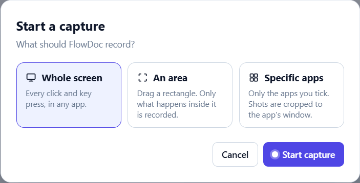
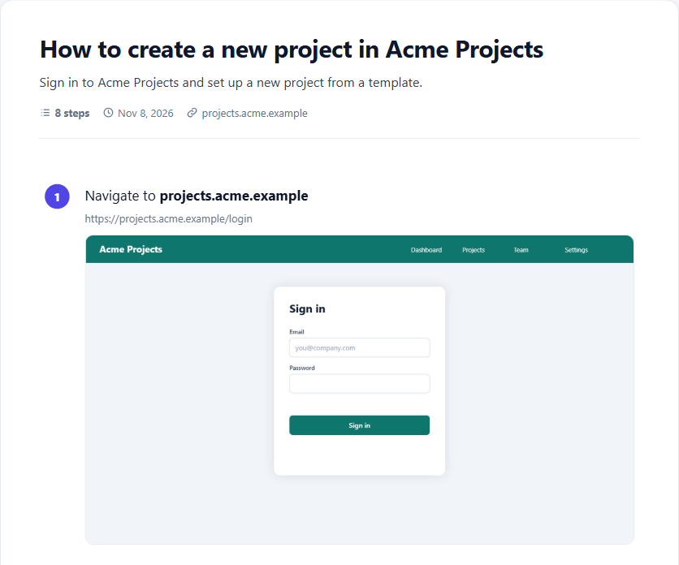
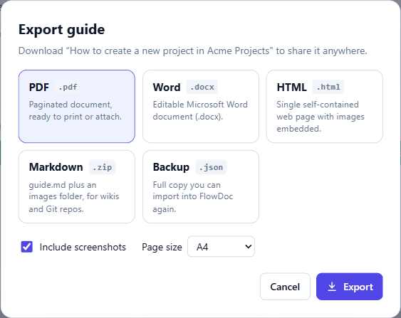

# FlowDoc

**Do a task on your PC once. FlowDoc writes the how-to guide for you, with screenshots.**

[Install](#install) · [User guide](docs/user-guide.md) · [Privacy](PRIVACY.md) · [Developers](docs/developers.md)

## Install

Pick your computer. Each one has full steps in the [installation guide](docs/installation.md).

<b>Windows</b>: download the installer (recommended)

 

1. Click **Download for Windows** above, or open the [latest release](https://github.com/avin045/FlowDoc/releases/latest).
2. Under **Assets**, click `FlowDoc.Setup.<version>.exe`, not "Source code".
3. Open the file and follow the installer. Keep **Only for me**: no administrator rights needed.

Needs Windows 10 (version 2004 or newer) or 11, 64-bit. Your browser or Windows may warn you before it runs, because FlowDoc is free and doesn't pay for a code-signing certificate. The source code is public. [What to click](docs/installation.md#if-your-browser-or-windows-warns-you) · [Full Windows steps](docs/installation.md#windows)

<b>Linux</b>: build from source

 

There's no Linux download yet. Build the desktop app from source and install it by following [Install on Linux](docs/installation.md#linux). The Linux build hasn't been tested on real hardware yet.

Rather not build anything? The Chrome / Edge extension below works on Linux too.

<b>Chrome or Edge extension</b>: any computer (Windows, Mac, Linux)

 

1. At the top of this page, click **Code** → **Download ZIP**, and unzip it to a folder you'll keep (not Downloads).
2. Open `chrome://extensions` (or `edge://extensions`) and turn on **Developer mode**.
3. Click **Load unpacked** and select the `extension` folder inside it.

The extension records what you do inside the browser only. [Full extension steps](docs/installation.md#chrome-and-edge-extension), including how to update without losing your guides.

> [!NOTE]
> No FlowDoc account, no FlowDoc server, no analytics. Your guides stay on your PC. Data leaves only if you turn on the optional AI (your own Gemini or Groq key) or Save to Notion. [Privacy policy](PRIVACY.md).
>
> FlowDoc records only after you press **New capture**, a recorder bar stays visible while it does, and passwords are never saved.

## How it works

|  |  |  |
| :---: | :---: | :---: |
| **1. Start a capture**, then do the task in any app | **2. Edit the steps**: FlowDoc wrote them and took the screenshots | **3. Export** to PDF, Word, HTML or Markdown |

## Features

| Works right away | Optional, needs setup |
| --- | --- |
| Records clicks and typing in any Windows app: File Explorer, Excel, Settings, your browser… | **Improve with AI**: rewrites the steps from the screenshots, using your own free Gemini or Groq key |
| Records the whole screen, one area, or only the apps you choose | **Translate** a guide into Tamil, Hindi, Spanish and many other languages (needs AI) |
| Edit steps, add tips and headings, reorder with drag and drop | **Save to Notion**: connect your own Notion and save guides as pages |
| Blur private details and crop screenshots | |
| Export to PDF, Word, HTML, Markdown or a backup file | |
| Passwords kept out of steps and screenshots | |
| Light and dark theme | |

## Documentation

The full manual moved to the **[user guide](docs/user-guide.md)**: recording, editing, exporting, AI, Notion, troubleshooting and limitations.

- [Installation guide](docs/installation.md): Windows, Linux, and the Chrome / Edge extension
- [Developers guide](docs/developers.md): build from source, run the tests, how the recorder works
- [Web workspace](docs/developers.md#web-workspace): try the editor and a sample guide in a browser, without recording
- [Release notes](https://github.com/avin045/FlowDoc/releases)

## License

FlowDoc is free and open source under the [Apache License 2.0](LICENSE). Copyright 2026 avin045.

[Contributing](CONTRIBUTING.md) · [Security](SECURITY.md) · [Privacy](PRIVACY.md)

FlowDoc is an alternative to tools like Scribe. It is not affiliated with Scribe.
